# biblioteca-js — biblioteca KiCad da UTFPR Rocket

Símbolos, footprints e referências de modelo 3D que **não existem nas bibliotecas padrão do KiCad**, reunidos a partir dos projetos da equipe (aviônica F-500, placa do teste estático, placa Ecodelta). Feita no **KiCad 10**.

[Instalar](#instalar) · [Catálogo](#catálogo) · [Estrutura](#estrutura) · [Modelos 3D](#modelos-3d) · [Projetos que usam](#projetos-que-usam)

## Instalar

1. Clone em uma pasta fixa:
   ```bash
   git clone https://github.com/stansca/kicad-biblioteca-js.git ~/Documents/KiCad/biblioteca-js
   ```
2. No KiCad: **Preferências → Configurar caminhos** → nova variável `JS_KICAD_LIB` apontando para a pasta clonada.
3. **Preferências → Gerenciar bibliotecas de símbolos** → aba *Global* → adicione cada `symbols/JS_*.kicad_sym` com o caminho `${JS_KICAD_LIB}/symbols/JS_<Categoria>.kicad_sym` (ou cole as linhas de [`tabelas/sym-lib-table`](tabelas/sym-lib-table) no seu arquivo de tabela global).
4. **Preferências → Gerenciar bibliotecas de footprints** → o mesmo com `${JS_KICAD_LIB}/footprints/JS_<Categoria>.pretty` ([`tabelas/fp-lib-table`](tabelas/fp-lib-table)).
5. Para atualizar: `git pull` na pasta. Os projetos não precisam mudar, porque tudo passa pela variável.

O campo *Footprint* de cada símbolo já aponta para o footprint certo desta biblioteca.

## Catálogo

### JS_Comunicacao — Rádio e GNSS

| Componente | Símbolo | Footprint | Usado em |
| --- | --- | --- | --- |
| **GPS_NEO-M8N** |  |  | F-500 |
| **LoRa_E32** |  |  | F-500 |

### JS_Conectores — Bornes e conectores

| Componente | Símbolo | Footprint | Usado em |
| --- | --- | --- | --- |
| **Borne_AK500-2** |  |  | F-500, Estático, Ecodelta |
| **TE_6437288-6** | 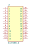 | 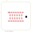 | Ecodelta |

### JS_Discretos — Discretos importados do Eagle (F-500 v1)

| Componente | Símbolo | Footprint | Usado em |
| --- | --- | --- | --- |
| **1N4004 / DO41-10** |  |  | F-500 |
| **Buzzer_F-QMX** |  |  | F-500 |
| **IRF620 / TO220** |  |  | F-500 |
| **LED_TLLR4400 / LED_3mm** |  | 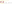 | F-500 |
| **R_0204-7 / R_Axial_0204-7** |  |  | F-500 |

### JS_Energia — Conversores e fusível

| Componente | Símbolo | Footprint | Usado em |
| --- | --- | --- | --- |
| **Buck_Conversor** | 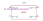 |  | Estático |
| **Buck_Conversor_Esq500m** | — |  | (versão antiga Esq-500m) |
| **Fusivel_3557-2** | 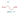 |  | Ecodelta |

### JS_Microcontroladores — Placas de desenvolvimento

| Componente | Símbolo | Footprint | Usado em |
| --- | --- | --- | --- |
| **ESP32-DevKitC-32E** | 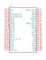 | 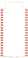 | F-500, Estático |

### JS_Modulos — Módulos prontos

| Componente | Símbolo | Footprint | Usado em |
| --- | --- | --- | --- |
| **SD_Card_Adapter** | 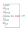 |  | Estático |

### JS_Reles — Relés automotivos

| Componente | Símbolo | Footprint | Usado em |
| --- | --- | --- | --- |
| **Rele_Automotivo_5P_12V_30A** | 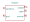 |  | Ecodelta |
| **VR05-PCB** | 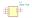 |  | (mini placa ecodelta antiga) |

### JS_Sensores — Sensores (barômetro, célula de carga)

| Componente | Símbolo | Footprint | Usado em |
| --- | --- | --- | --- |
| **BMP280_Modulo** |  |  | F-500 |
| **HX711_Modulo** | 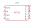 |  | Estático |
| **HX711_Modulo_Alt** | 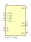 |  | (extra, de KiCad-Library) |
| **HX711_SOP-16_3.9x9.9mm_P1.27mm** | — |  | (extra, CI HX711) |

`JS_Discretos` são peças importadas do Eagle na F-500 v1. Em projetos novos, prefira os equivalentes padrão do KiCad (`Device:R`, `Device:LED`, `Diode:1N4004`, `Transistor_FET:IRF620`…).

## Estrutura
```
symbols/JS_<Categoria>.kicad_sym      símbolos, um arquivo por categoria
footprints/JS_<Categoria>.pretty/     footprints
3dmodels/                             modelos 3D (baixar do fabricante, ver abaixo)
previews/                             imagens SVG geradas pelo kicad-cli (para este README)
tabelas/                              linhas prontas para as tabelas de bibliotecas do KiCad
```
Para regenerar as prévias depois de editar a biblioteca: `./gerar_previews.sh`.

## Modelos 3D
Os modelos `.step` dos fabricantes **não estão no repositório** (direitos de redistribuição). Baixe no site de cada fabricante e salve em `3dmodels/` com estes nomes, que são os referenciados pelos footprints:

| Arquivo | Peça |
| --- | --- |
| `3dmodels/3557-2.step` | Porta-fusível Keystone 3557-2 (`Fusivel_3557-2`) |
| `3dmodels/6437288-6.step` | Conector TE Connectivity 6437288-6 (`TE_6437288-6`) |
| `3dmodels/VR05-PCB.stp` | Relé VR05 (`VR05-PCB`) |

## Projetos que usam
- Aviônica F-500 (v1 e v2) — [f500-avionica](https://github.com/stansca/f500-avionica)
- Placa do teste estático — [placa-estatico](https://github.com/stansca/placa-estatico)
- Placa Ecodelta — [placa-ecodelta](https://github.com/stansca/placa-ecodelta)
